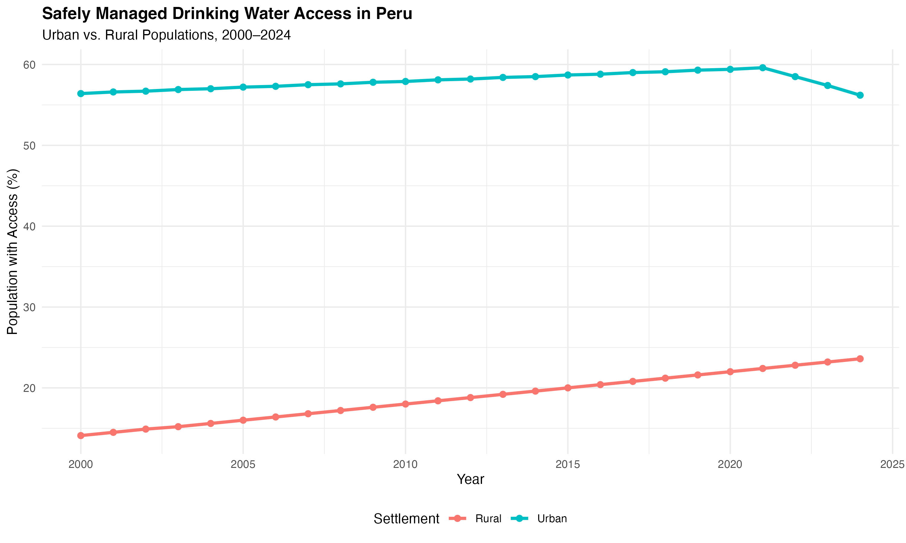
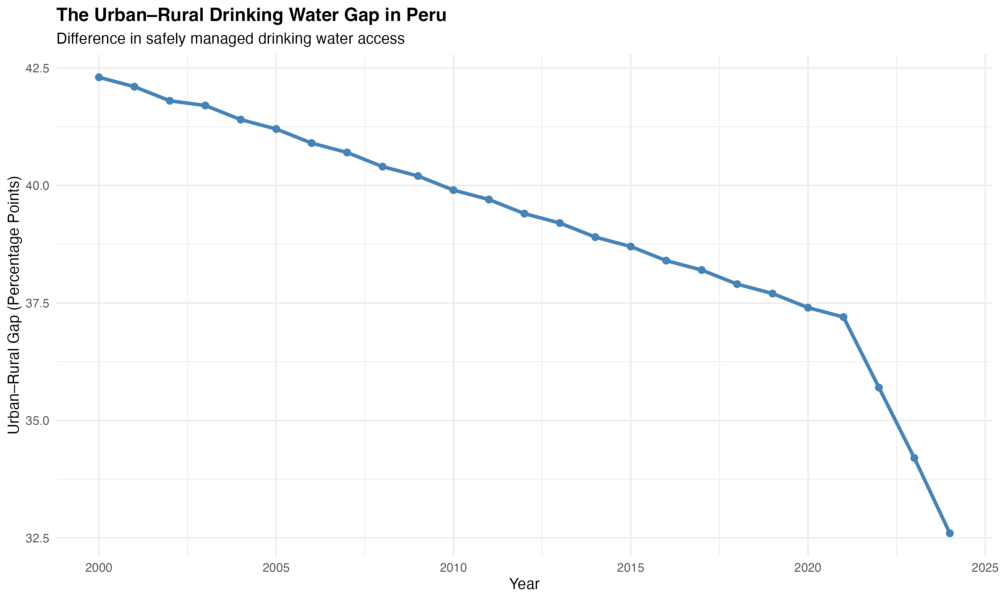
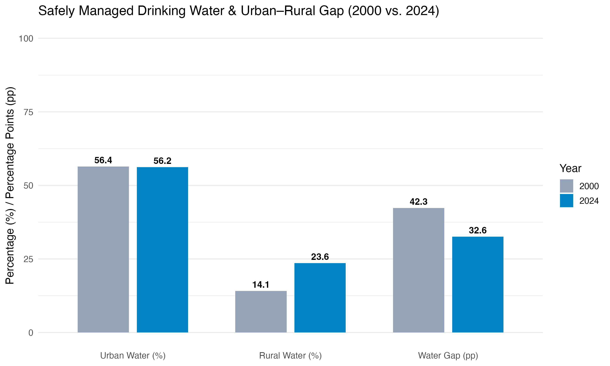

# peru-wash-inequality-analysis

# Geographic Inequality in Safely Managed Drinking Water Services in Peru (2000–2024)

## Project Overview

This project examines geographic inequality in access to safely managed drinking water services across urban and rural populations in Peru between 2000 and 2024.

Using household estimates from the WHO/UNICEF Joint Monitoring Programme (JMP), I analyzed long-term trends in drinking water coverage and measured changes in the urban–rural disparity.

**Research Question:** How has the disparity in safely managed drinking water services between urban and rural populations in Peru changed from 2000 to 2024?

## Key Findings

The analysis identified three key findings:

- **Urban coverage:** Decreased slightly from 56.4% in 2000 to 56.2% in 2024.
- **Rural coverage:** Increased from 14.1% in 2000 to 23.6% in 2024.
- **Urban–rural disparity:** Narrowed from 42.3 to 32.6 percentage points, a reduction of 9.7 percentage points.

Although the disparity narrowed over the study period, rural coverage remained substantially below urban coverage in 2024.

## Visualizations

### 1. Urban and Rural Drinking Water Coverage Over Time

### 2. Change in the Urban–Rural Coverage Gap

### 3. Comparison of Urban and Rural Coverage in 2000 and 2024

## Data Source

**Primary source:** [WHO/UNICEF Joint Monitoring Programme (JMP) – Household Drinking Water, Sanitation and Hygiene Data](https://washdata.org/data/info/household)

The analysis uses Peru's 2025 JMP household estimates, covering the period 2000–2024.

## Indicator Definition

The primary variable analyzed is `agua_potable_gestionado_de_manera_segura`, corresponding to the JMP indicator 'Safely Managed Drinking Water Services'.

Under the JMP definition, safely managed drinking water requires an improved drinking water source that is:
- Accessible on premises
- Available when needed
- Free from fecal and priority chemical contamination

The indicator measures the percentage of the population using safely managed services, rather than the percentage of households.

## Methodology

The analysis was conducted in R and involved:

1. Importing and cleaning the JMP household estimates.
2. Examining missing values, duplicate records, and data consistency.
3. Filtering annual estimates from 2000 through 2024.
4. Separating urban and rural population estimates.
5. Calculating annual differences between urban and rural drinking water coverage.
6. Visualizing long-term trends and comparing results across the study period.

The urban–rural gap is calculated as:

**Urban coverage − Rural coverage = Urban–Rural Gap (percentage points)**

## Tools and Technologies

- **R**
- Tidyverse
- Readxl
- Janitor
- Skimr
- Ggplot2

## Important Considerations and Limitations

JMP annual values are statistical estimates, not necessarily direct observations from a household survey conducted every year. Estimates draw on available national household surveys, censuses, and administrative data, using statistical methods to produce annual trends.

A percentage-point difference is used to measure the urban–rural gap. The urban and rural coverage percentages have separate population denominators and should not be interpreted as shares of a single total.

## Future Directions

This project is an initial exploration of geographic inequality in essential services in Peru. Future analysis will expand to safely managed sanitation and basic hygiene services to examine broader disparities in access to water, sanitation, and hygiene (WASH).
